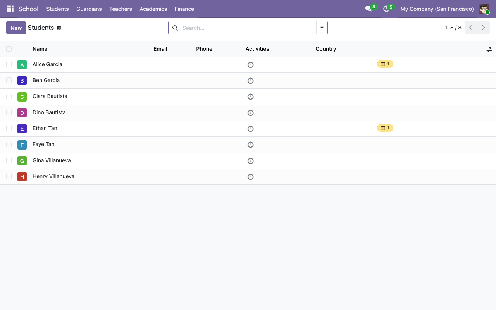
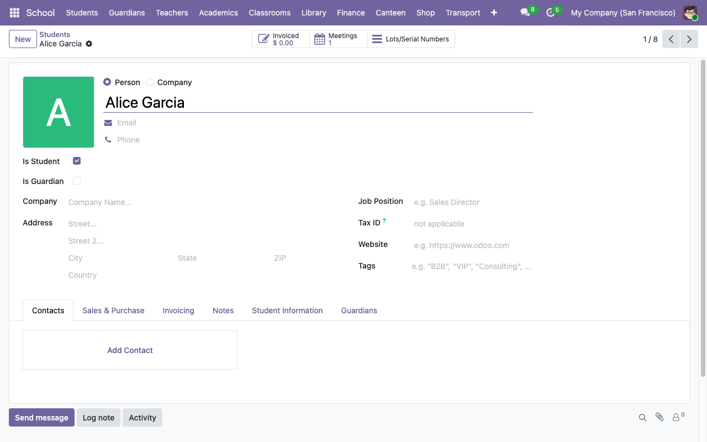
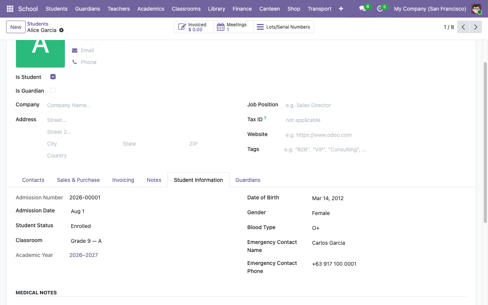

# Adding a student

A "student" in this system is a `res.partner` record with `is_student = True`. The flag unlocks the **Student Information** tab on the contact form and exposes school-specific fields (admission number, classroom, guardians, medical, emergency contact).

## 1. Open the Students list

**School → Students**. You'll see every partner already flagged `is_student`.

## 2. Click New

The form opens with the **Is Student** checkbox visible at the top.

Fill in the standard partner fields (name, email, phone, address), then tick **Is Student**. Leave **Is Guardian** off — a person can technically be both (e.g. adult learners with dependents), but the common case is one or the other.

## 3. Open the Student Information tab

Once you've ticked **Is Student**, a new notebook tab named **Student Information** appears at the bottom of the form. Click it.

Fields:

| Field | Notes |
|---|---|
| **Admission Number** | Auto-generated on save via the `school.student.admission` sequence (default format `<year>-NNNNN`, e.g. `2026-00001`). Leave blank and Odoo fills it. |
| **Admission Date** | Defaults to today. |
| **Student Status** | `Enrolled` / `On Leave` / `Graduated` / `Withdrawn`. Start with `Enrolled`. |
| **Classroom** | Pick the active classroom for the current academic year. |
| **Academic Year** | Auto-filled from the classroom. Read-only. |
| **Date of Birth**, **Gender**, **Blood Type** | Self-explanatory. |
| **Emergency Contact Name / Phone** | The person the school calls if something goes wrong. |

Set whatever you know and save.

## 4. Link guardians

Switch to the **Guardians** tab on the same form and add the student's parents / guardians. Each guardian is itself a `res.partner` — click the dropdown and either pick an existing one or click **Create and edit...** to add a new guardian record (tick **Is Guardian** on that new partner).

Guardian ↔ ward is a **symmetric many-to-many**: linking Carlos Garcia as a guardian of Alice automatically adds Alice to Carlos's **Wards** tab.

## 5. (Optional) Create a portal user for the guardians

See [Giving guardians portal access](09-portal-access.md) — this lets them sign in at `/my/school` and see grades, attendance, and fees for all their wards.

## Admission number format

By default the sequence produces `<year>-NNNNN` (e.g. `2026-00001`). To change the format (e.g. to use a school-specific prefix like `RES-`):

1. **School → Configuration → Admission Number Sequence** (manager-only).
2. Edit the **Prefix** field (`%(range_year)s-` is the default — Python template substitution). You can also change padding and next-number fields.
3. Save. Every new student will use the updated format; existing admission numbers are not renumbered.

## Promoting a contact to a student

You can flip any existing `res.partner` into a student by ticking **Is Student**. On save, an admission number is auto-generated if one wasn't already set. All the standard contact data (email, phone, address, tags) is preserved.

## What happens on delete

Deleting a student is a full `res.partner` delete. It will fail (via `ondelete="restrict"` on the guardian m2m and the classroom assignment) if the student is actively linked elsewhere. The cleaner lifecycle is to set **Student Status → Graduated** or **Withdrawn** instead of deleting.

## Next steps

- [Assigning a student to a classroom](02-classrooms-and-cohorts.md)
- [Enrolling the student in courses](03-academics-and-courses.md)
- [Creating a fee enrollment](05-fees-and-invoices.md)
