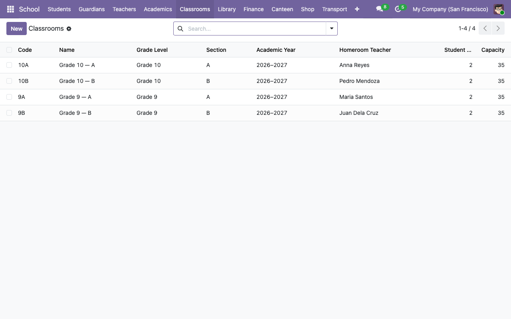

# Classrooms and cohorts

A **classroom** in this system is scoped to an academic year, has a grade level (K–12), and optionally a homeroom teacher. Students are assigned to one classroom at a time via `res.partner.student_classroom_id`.

## 1. Create the academic year

**School → Configuration → Academic Years → New**.

| Field | Notes |
|---|---|
| **Name** | Display name (e.g. `2026–2027`). |
| **Code** | Short unique key for cross-module references (e.g. `AY2627`). |
| **Start Date** / **End Date** | Calendar bounds. |
| **State** | `draft` → `active` → `archived`. **Only one year can be `active` at a time** (enforced by a Python constraint). |

## 2. Add terms

Scroll to the **Terms** notebook tab on the academic year form. Click **Add a line** and create each term:

| Field | Notes |
|---|---|
| **Name** | E.g. `First Semester`. |
| **Code** | Unique within the academic year. E.g. `S1`. |
| **Start / End Dates** | Must fall within the parent year's date range and not overlap other terms in the same year (enforced). |

A typical US school year is two terms (S1 Aug–Dec, S2 Jan–May). Quarterly schools use four; IB schools use three; some colleges use six. All of these work.

## 3. Create classrooms

**School → Classrooms → New**.

| Field | Notes |
|---|---|
| **Name** | Full display label (e.g. `Grade 10 — A`). |
| **Code** | Short unique label **per academic year** (e.g. `10A`). |
| **Grade Level** | `K` through `12`. Required. |
| **Section** | Letter / name that distinguishes sections of the same grade. |
| **Capacity** | Hard limit; the form will refuse to accept a new student above this number. Default `30`. |
| **Academic Year** | Required. |
| **Homeroom Teacher** | Optional. Picker is filtered to `hr.employee` records flagged `is_teacher`. |

## 4. Add students to the classroom

Two equivalent routes:

- **From the student form**: open the student, go to the **Student Information** tab, pick the classroom. The student's `student_academic_year_id` is filled in automatically from the classroom.
- **From the classroom form**: open the classroom, go to the **Students** tab, click **Add a line** to pick an existing student.

The student count at the top of the classroom form (`student_count`) is computed live and checked against `capacity` on write.

## Moving a student to a new classroom

Just change the classroom on the student's form. The student count on the old classroom drops and the count on the new one goes up. The `student_academic_year_id` updates automatically.

## Tracking cohorts across years

Each classroom is bound to **one** academic year. At promotion time you'd typically:

1. Archive the old academic year (set state → `archived`).
2. Create the new academic year and its terms.
3. Create next year's classrooms (e.g. `11A`, `11B` for the students who were in `10A`/`10B`).
4. Bulk-update each promoted student's classroom to the new one.

The system doesn't have a built-in "promote cohort" wizard yet. The blueprint for adding one is in `docs/plan/` if you want to contribute it.

## Homeroom teacher vs course teacher

- **Homeroom teacher** (on the classroom) is the teacher responsible for the cohort overall — attendance, pastoral care, reporting.
- **Course teacher** (on `school.course`) is who teaches a specific subject for a classroom+term. One teacher can appear on many courses; one course has exactly one teacher.

The homeroom teacher often also teaches one or more courses for that classroom, but they don't have to. In the demo data, Maria Santos is homeroom for 9A and teaches Math for every classroom.

## Next steps

- [Academics: subjects and courses →](03-academics-and-courses.md)
- [Session scheduling and attendance →](03-academics-and-courses.md#session-scheduling)
