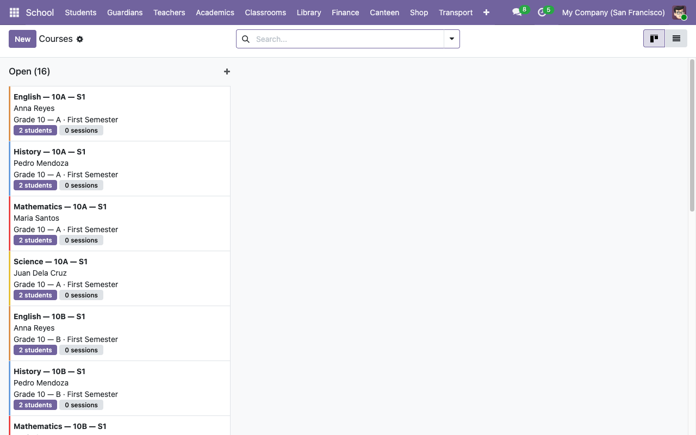
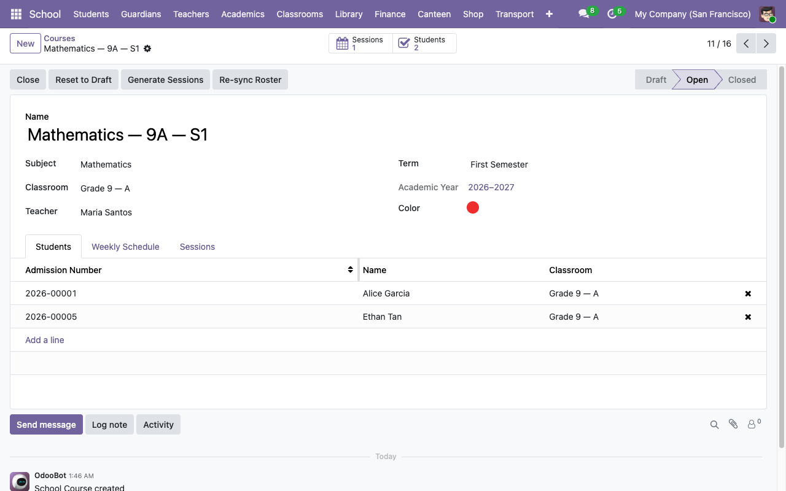

# Academics — subjects, courses, sessions, attendance

The academic layer is built around three concepts:

- **Subject** — a curriculum item (e.g. *Mathematics*, *World History*). One per subject name, reused across classrooms and years.
- **Course** — a concrete offering of a subject for a specific classroom, term, and teacher. E.g. *Mathematics — 9A — S1*. Students are auto-enrolled from the classroom roster.
- **Session** — a single class meeting. Stored as a regular `calendar.event` with a link back to the course. Generated from a weekly schedule pattern.

## 1. Catalog your subjects

**School → Configuration → Subjects → New**.

Keep subjects general. *Mathematics* rather than *Algebra II — Grade 10 Section A*, because the subject gets reused across classrooms and years. The specificity lives on the course, not the subject.

## 2. Create courses

**School → Academics → Courses**.

Default view is a kanban grouped by state:

Click **New**. Fill in:

| Field | Notes |
|---|---|
| **Subject** | From the catalog. |
| **Classroom** | The cohort that will take this course. |
| **Teacher** | Picker is filtered to `is_teacher` employees. |
| **Term** | Determines date range for session generation. |

The course **name** is auto-generated from *Subject — Classroom.code — Term.code* (e.g. `Mathematics — 9A — S1`). You can override it if you want a different label.

When you save, the course's **Students** tab auto-populates from the classroom's current roster. If students are added/removed from the classroom later, click **Re-sync Roster** on the course form to refresh.

## Session scheduling

Each course has a **Weekly Schedule** tab. Each line represents a weekly meeting slot:

| Field | Notes |
|---|---|
| **Weekday** | Mon / Tue / Wed / Thu / Fri / Sat / Sun. |
| **Start Time** | 24-hour float. `10.5` means 10:30. |
| **Duration** | Hours. Max 8. |
| **Location** | Free-text. Defaults to the classroom's display name if left blank. |

Once the rules are in, click **Generate Sessions** in the form header. Odoo walks the term's date range and creates a `calendar.event` for every matching weekday × time combination, with:

- `school_course_id = <this course>`.
- `school_session_state = 'scheduled'`.
- All enrolled students added as attendees (so they see the meeting in their calendar).

The action is **idempotent** — re-running it only creates sessions for dates that don't already have one. Safe to click twice.

## Marking attendance

Attendance is **per-session, per-student**. Each attendance record has a `state`: `present`, `absent`, `late`, `excused`.

Two ways to enter attendance:

1. **Bulk "Mark All Present"** — open the session (either from the course's Sessions tab or from `/odoo/calendar`), scroll to the attendance panel, and click **Mark All Present**. This creates a `present` row for every enrolled student that doesn't already have one, and flips the session to `completed`. Existing rows (e.g. marked absent) are NOT overwritten.

2. **Row-by-row** — add / edit attendance lines directly on the session form. Pick the student, pick the state, add a note.

Two safety nets enforce data integrity:

- `UNIQUE(exam_id, student_id)` at the DB level — you can't record the same student twice on a session.
- `@api.constrains` at the ORM level — the student must be enrolled in the session's course. Adding a non-enrolled student raises a `ValidationError`.

## Changing the roster mid-term

Students who transfer into a classroom after courses were created aren't automatically added to those courses. You have two options:

- Open each course, click **Re-sync Roster**. Pulls the full current classroom roster into the course.
- Or add the student manually to the course's **Students** tab.

**Re-sync Roster** is idempotent and doesn't remove students who are on the course but not the classroom — so if you've deliberately added an outside student (e.g. a 10th grader sitting in on a 9A course as an elective), they stay.

## Next steps

- [Exams and grading →](04-exams-and-grades.md)
- [Report cards →](04-exams-and-grades.md#report-cards)
