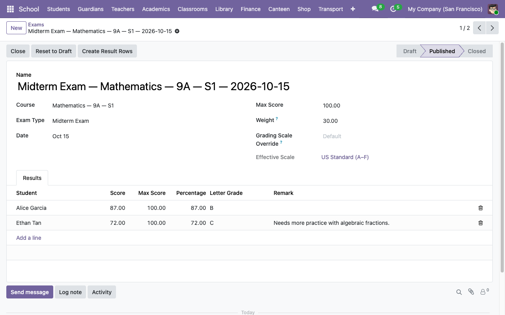
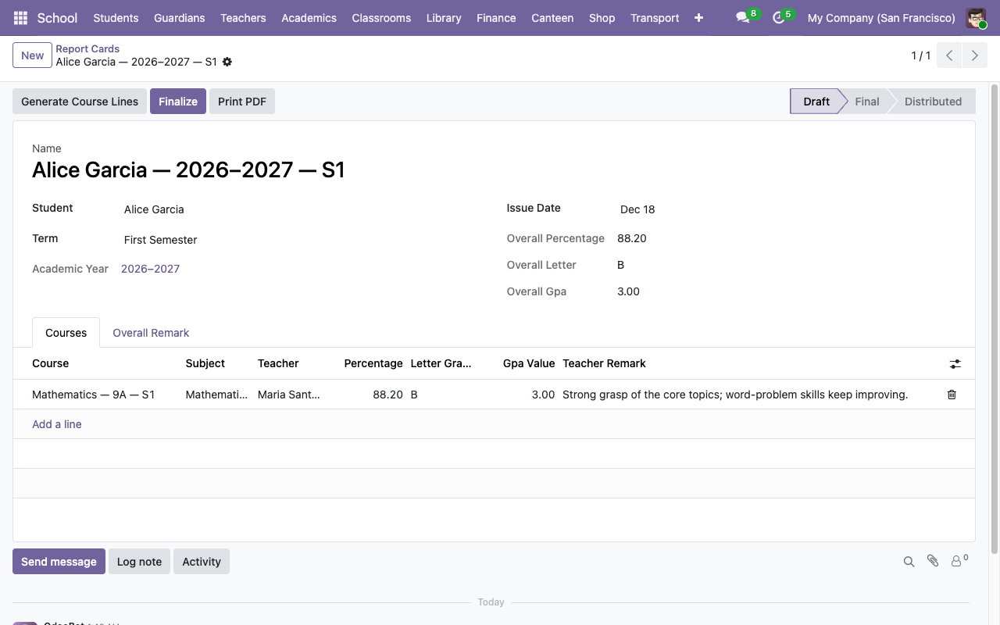

# Exams, grades, and report cards

The grading pipeline has four stages:

```
Grading Scale  ─┐
                 ├→ Exam Types → Exams → Exam Results ┐
Course ─────────┘                                      │
                                                       ▼
                                            Report Card + PDF
```

- **Grading scale** defines the letter/GPA bands a percentage maps to.
- **Exam type** defines a class of assessment and its default weight.
- **Exam** is one concrete assessment tied to a course.
- **Exam result** is one student's score on that exam.
- **Report card** rolls up all the student's results for a term into a per-course weighted average and an overall GPA.

## Grading scales

**School → Configuration → Grading Scales**.

Two shipped with the demo: *US Standard (A–F)* (default) and *Philippine DepEd* (1.00 top, 5.00 bottom). You can add your own.

Each scale has **bands** — rows with:

| Field | Notes |
|---|---|
| **Letter** | The letter/mark shown on results (e.g. `A`, `B+`, `1.25`). |
| **Minimum %** | Inclusive lower bound. The highest-matching band wins. |
| **GPA Value** | Numeric GPA for this letter. E.g. `4.0` for A. |
| **Sequence** | Display order in the form. |

Exactly one scale has `is_default = True`. That's the scale used whenever an exam doesn't override it.

## Exam types

**School → Configuration → Exam Types**. Shipped with: `Quiz` (default weight 20), `Midterm Exam` (30), `Final Exam` (50). Add custom types (e.g. `Project`, `Homework Set`) as needed. The weight on an exam type is just a default seeded onto new exams of that type — you can always override it per exam.

## Creating an exam

**School → Academics → Exams → New**.

| Field | Notes |
|---|---|
| **Course** | The exam belongs to one course. Determines who can be graded. |
| **Exam Type** | Seeds the default weight. |
| **Date** | When the exam happens. |
| **Max Score** | Denominator for percentage calc. Default 100. |
| **Weight** | This exam's contribution to the course's final grade, in percent. Seeded from the exam type; editable. |
| **Grading Scale Override** | Optional — if blank, the default scale is used. The **Effective Scale** field below shows which one will actually be applied. |

Save, then click **Publish** in the header. The state moves from `draft` to `published`, which is the state used by the report-card pipeline.



## Entering results

Two ways:

1. **Bulk placeholders** — on a published exam, click **Create Result Rows**. The system creates a blank row for every enrolled student with `score = 0`. Teachers edit the scores afterward.

2. **Row-by-row** — use the **Results** tab. Add lines one at a time.

Each result row fills in automatically:

- **Percentage** = `score / max_score × 100`.
- **Letter Grade** — looked up on the exam's effective scale.
- **GPA Value** — the matching band's GPA.
- **Remark** — free text, optional.

Safety nets:

- Score ∈ `[0, max_score]` — validation error otherwise.
- The student must be enrolled in the exam's course.
- Unique `(exam, student)` — no double scoring.

When you edit a score, the computed fields update live. No need to "save and recompute".

## Course grades and weighted averages

A student's grade in a course is computed **on demand** when their report card line for that course is built:

```
graded_results = student's results on course exams whose state is 'published' or 'closed' with weight > 0
if graded_results is empty  → line marked Incomplete
else:
    percentage = Σ(result.percentage × exam.weight) / Σ(exam.weight)
    letter_grade = scale.band_for_percentage(percentage).letter
    gpa_value   = that band's GPA
```

This is a **weighted** average — a midterm worth 30 and a quiz worth 20 end up contributing in 3:2 ratio to the final grade. Missing exam results don't penalize (they're skipped, not zeroed) unless you explicitly record a score of 0.

## Report cards

**School → Academics → Report Cards → New**.



| Field | Notes |
|---|---|
| **Student** | Required. Picker is filtered to `is_student`. |
| **Term** | Required. Determines which exams count. |
| **Issue Date** | Default today. |
| **State** | `draft` → `final` → `distributed`. |

Steps:

1. **Save** the draft card.
2. Click **Generate Course Lines** in the header. The system enumerates every course the student is enrolled in for that term and creates a line per course, with `percentage` / `letter_grade` / `gpa_value` / `is_incomplete` computed from the current exam results.
3. Add a teacher remark per course line if you want (free text).
4. Add an overall teacher remark at the bottom if you want.
5. Click **Finalize** to move the state to `final` and freeze the computation.

### Printing the PDF

Click **Print PDF** on the form header, or use **Print → Report Card** from the action menu. You get a single-page A4 PDF with:

- School name + logo from `res.company`.
- Student block (name, admission #, classroom).
- Term + academic year.
- Course table — subject | teacher | % | letter | GPA | remark.
- Overall footer — % / letter / GPA.
- Teacher remark (if set).
- Signature lines for Homeroom Teacher + Principal.

## Next steps

- [Fees and invoices →](05-fees-and-invoices.md)
- [Automated notifications →](08-communications.md)
