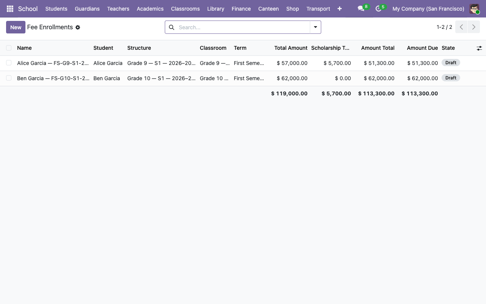
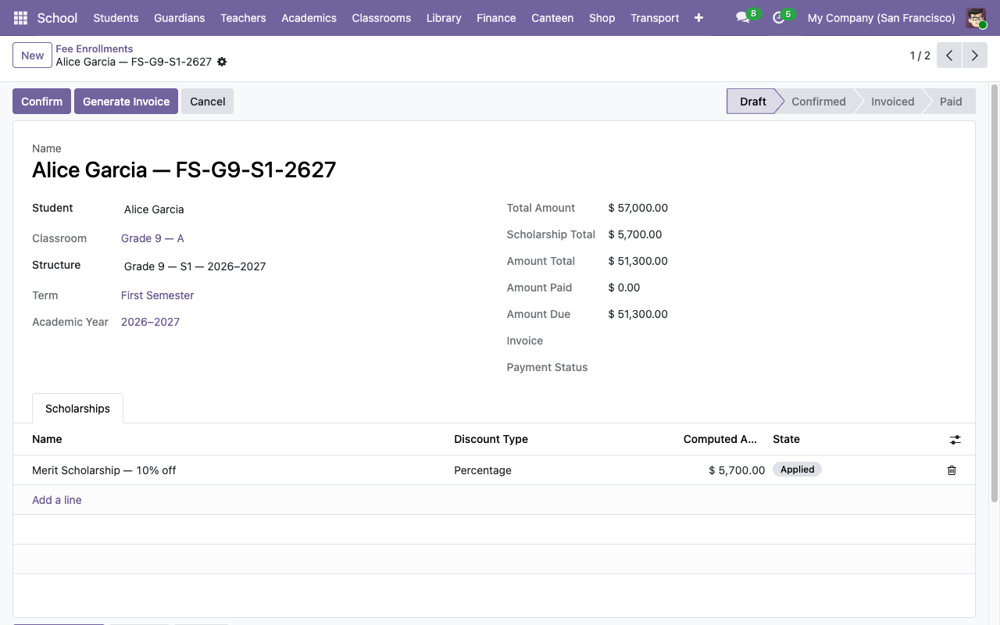

# Fees, enrollments, and invoices

The fee pipeline in four steps:

```
Fee Items (products)
     │
     ▼
Fee Structure (bundle for grade × term)
     │
     ▼
Fee Enrollment (one per student)
     │
     ▼  Generate Invoice
account.move (customer invoice)
```

## 1. Create fee items

**School → Configuration → Fee Items → New**.

A fee item is just an Odoo product flagged `is_school_fee = True`. Set:

- **Name** — e.g. `Tuition Fee`, `Lab Fee`, `Activity Fee`.
- **Type** — `Service` is a safe default.
- **Sales Price** — base price.
- Ignore Purchase/Inventory/etc. tabs unless you need them.

Because fee items are regular products, Odoo's pricing, taxes, and income accounts flow through for free. If you want tax on tuition, set the tax on the product; it carries through to the invoice automatically.

## 2. Build a fee structure

**School → Configuration → Fee Structures → New**.

A fee structure is a **grade-level × term** bundle — e.g. *Grade 9 Fees, Fall 2026*. Because it's scoped to a grade, one structure automatically applies to every classroom at that level (9A, 9B, ...).

| Field | Notes |
|---|---|
| **Code** | Short unique key (e.g. `FS-G9-S1-2627`). |
| **Grade Level** | `K` through `12`. |
| **Term** | Links this structure to one term. |
| **Currency** | Defaults to company currency. |

Then add **Items** — one line per fee component:

| Line field | Notes |
|---|---|
| **Product** | Picker filtered to `is_school_fee = True`. |
| **Quantity** | Usually `1`. Use higher for multi-unit fees. |
| **Price Unit** | Seeded from the product's list price; editable. |
| **Subtotal** | Computed `qty × price`. |

The **Total Amount** at the top rolls up. Set **State** to `open` when you're ready to enroll students.

## 3. Enroll students

**School → Finance → Fee Enrollments**.



Click **New**, pick the student and the structure. The system enforces that the student's classroom grade level matches the structure's grade — you can't accidentally put a Grade 9 student on a Grade 10 fee schedule.



The form auto-populates the rollups:

| Field | Derivation |
|---|---|
| **Total Amount** | Related from `structure.total_amount`. |
| **Scholarship Total** | Sum of applied scholarships (see step 4). |
| **Amount Total** | `total − scholarship_total`. |
| **Amount Paid** | From the generated invoice (updates after posting + payment). |
| **Amount Due** | `amount_total − amount_paid`. |

**State lifecycle**: `draft` → `confirmed` → `invoiced` → `paid` → `cancelled`.

## 4. Apply a scholarship

On the enrollment form, go to the **Scholarships** tab and click **Add a line**.

| Field | Notes |
|---|---|
| **Name** | Required (e.g. `Merit Scholarship — 10% off`, `Sibling Discount`). |
| **Discount Type** | `Fixed Amount` or `Percentage`. |
| **Amount** / **Percentage** | Mutually exclusive. Fill in exactly one. |
| **Reason** | Free text. Useful for audit trails. |
| **State** | `draft` → `applied` → `revoked`. |

Only scholarships in **Applied** state deduct from the enrollment total. That two-step gate (create in draft, then apply) lets you queue up a batch and flip them live at once.

## 5. Generate the invoice

Click **Generate Invoice** on the enrollment form. The system:

1. Creates a draft `account.move` with `move_type = out_invoice`, `partner_id = student`, `invoice_origin = enrollment.display_name`.
2. Adds one line per fee-structure item (product, quantity, price).
3. Adds one negative line per applied scholarship (named `Scholarship: <name>`, `price_unit = -computed_amount`).
4. Subscribes the student's guardians as invoice followers — they receive invoice notifications via Odoo mail.
5. Moves the enrollment state to `invoiced` and stores the invoice reference in `enrollment.invoice_id`.

The invoice is left in **Draft** for Accounting to review and post. We deliberately don't auto-post so someone in Finance has a chance to sanity-check before it hits the books.

### Once it's posted

Posting the invoice in Accounting triggers the normal Odoo payment flow. As payments are registered against it, `enrollment.amount_paid` and `enrollment.amount_due` update automatically, and `enrollment.payment_state` mirrors `invoice.payment_state` (not_paid / in_payment / paid / partial).

## 6. Handling changes after invoicing

Odoo's accounting integrity rules make post-hoc invoice edits painful. So the flow is:

1. Click **Cancel** on the enrollment — cancels the invoice too (if it's still in draft).
2. Edit the enrollment (add/remove scholarships, adjust lines, change the student's structure).
3. Click **Reset to Draft**, then **Generate Invoice** again.

If the original invoice is already **posted**, cancelling requires you to first go into Accounting and reset the invoice to draft.

## Fee invoices menu

**School → Finance → Fee Invoices** gives you a pre-filtered view of `account.move` records that originated from a fee enrollment (via the `school_enrollment_ids` inverse field on `account.move`). Use this to filter to "just school invoices" when the Accounting Invoices view gets crowded with other customer invoices.

## Next steps

- [Library workflows →](06-library.md)
- [Canteen wallets and purchases →](07-canteen.md)
- [Automated mail notifications →](08-communications.md)
