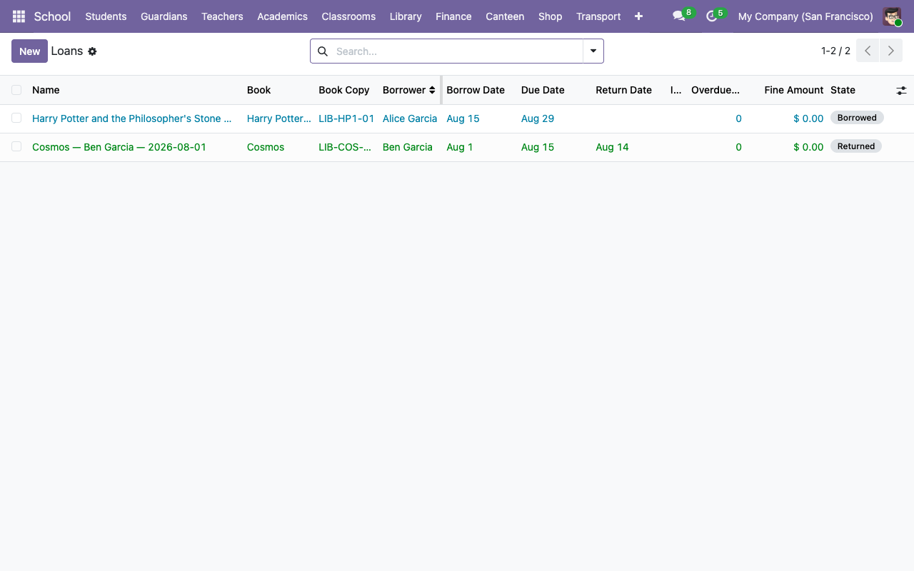

# Library — books, copies, and loans

The library in this system separates **titles** from **physical copies**:

- `school.library.book` — the title metadata (ISBN, authors, category, publisher).
- `school.library.book.copy` — one physical copy with a unique barcode.
- `school.library.loan` — a borrow transaction tying a copy to a borrower.

A title can have 0..N copies; each copy circulates independently. So *Harry Potter* can have 3 copies, two of which are out on loan and one available — students aren't fighting for "the" copy.

## 1. Set up categories and authors (once)

**School → Configuration → Library Categories → New** — e.g. `Fiction`, `Science`, `History`. One line each.

**School → Configuration → Library Authors → New** — name + optional bio per author. Authors are m2m on books, so one author can have many titles.

## 2. Add a book title

**School → Library → Books → New**.

| Field | Notes |
|---|---|
| **Title** | Required. |
| **ISBN** | Required to be unique if set (enforces DB-level). Leave blank for books without an ISBN. |
| **Authors** | Many-to-many. Pick one or more. |
| **Category** | Single category. |
| **Publisher** | Free text. |
| **Publish Date** | Optional date. |
| **Summary** | Long-form description, displayed to teachers. |

## 3. Add copies

On the book form, go to the **Copies** tab and click **Add a line**. Fill in a unique **barcode** (the school's sticker / RFID ID) and save. The copy defaults to `available`.

Typical practice: label every copy with the scheme `LIB-<book_code>-<nn>` (e.g. `LIB-HP1-01`, `LIB-HP1-02`). The demo data uses this pattern.

## 4. Check out a book

**School → Library → Loans → New**.

| Field | Notes |
|---|---|
| **Book Copy** | Picker is filtered to copies with `state != 'lost'`. |
| **Borrower** | Any `res.partner`. Typically a student. |
| **Borrow Date** | Default today. |
| **Due Date** | Auto-computed as `borrow_date + loan_period_days` (config param, default 14). Editable. |

Click **Confirm Borrow**. Two things happen atomically:

- The loan state moves to `borrowed`.
- The copy state flips to `borrowed` (so nobody can double-borrow it).

If the copy is already `borrowed`, `lost`, or `damaged`, the form raises a UserError instead of letting you confirm.



## 5. Return a book

Open the loan. Click **Mark Returned** in the header. Today's date is recorded as the return date; the loan state becomes `returned` if on time or `returned_late` if after the due date; the copy state flips back to `available`.

## 6. Overdue detection and fines

While a loan is in `borrowed` state, these fields update automatically every time the record is read:

- **Is Overdue** — true if today > due_date.
- **Overdue Days** — `max(0, today − due_date)`.
- **Fine Amount** — `overdue_days × fine_per_day`.

If the book is returned late (`returned_late`), the overdue days lock at `return_date − due_date` and the fine amount crystallises.

The **fine per day rate** is read from `ir.config_parameter` key `school_library.fine_per_day` (default `5.0`). To change it:

1. **Settings → Technical → System Parameters**.
2. Find `school_library.fine_per_day`.
3. Update the value. Future fine computations will use the new rate.

The **default loan period** is the parallel key `school_library.loan_period_days` (default `14`).

## 7. Lost books

From a loan in `borrowed` state, click **Mark Lost**. Both the loan and the copy go to `lost`. The copy is no longer available for future loans. Collect the replacement fee from the borrower out-of-band (a future module could bridge this into `school_fees`).

## Loan state diagram

```
             ┌────── Confirm Borrow ──────┐
             │                            │
           draft ───────────────────→ borrowed ──── Mark Returned ──→ returned / returned_late
             │                            │
             └────── Mark Lost ───────────┴────── Mark Lost ──→ lost
```

**Reset to Draft** is available from any non-draft state; it rolls back the loan and flips the copy back to `available` if the loan was the one holding the copy.

## Quick queries

- Overdue right now: **School → Library → Loans**, apply filter **Overdue**.
- A specific borrower's history: **Loans**, search by borrower name.
- Available copies of a specific book: open the book, look at the **Copies** tab and filter by state. Or **School → Library → Copies** and filter by book + available.

## Next steps

- [Canteen: wallets and dietary tags →](07-canteen.md)
- [Transport: routes and assignments →](../admin-guides/)
