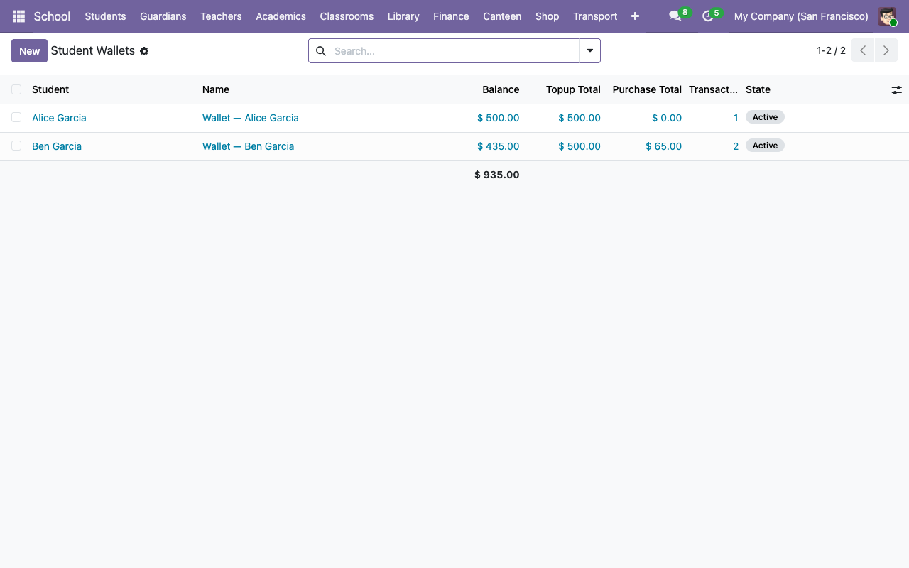

# Canteen — wallets and purchases

The canteen module gives every student a prepaid wallet, tracks top-ups and purchases, and refuses to let a student buy something they're allergic to.

## 1. Set up dietary tags

**School → Configuration → Dietary Tags → New**.

A dietary tag has a name (e.g. `Contains Nuts`), a short code (`nuts`), and a color. The **same tag model** is reused on both sides:

- On a canteen product: "this item contains X".
- On a student's profile: "this student is allergic to X".

When the sets intersect on a purchase, the system blocks it.

## 2. Flag canteen products

**School → Configuration → Canteen Items → New**.

A canteen product is a regular Odoo product flagged `is_canteen_item = True`. On the product form:

- Tick **Is Canteen Item**.
- Fill in **Dietary Tags** — what the product contains.
- Set **Type** to `Consumable` (or `Product` if you want stock tracking).
- Set the **Sales Price**.

Save.

## 3. Record student allergies

Open the student's record (**School → Students → Alice**), go to the **Student Information** tab, and fill in **Canteen Allergies**. This is a many-to-many picker against the dietary-tag catalog.

## 4. (Optional) Publish today's menu

**School → Canteen → Daily Menus → New**.

A menu has a date and a list of items. Set its state to **Published** and kids can see what's available. The menu is display-only — a student can buy any canteen product, not just ones on today's menu. (Schools that need the menu to be a hard gate can implement that via a constraint; out of scope for the base workflow.)

## 5. Create a wallet

**School → Canteen → Wallets → New**. Pick a student. Each student can have exactly one wallet (enforced by unique constraint).

New wallet starts with balance `0.00` in the active state.

## 6. Top up the wallet

On the wallet form, go to the **Transactions** tab and click **Add a line** — or use **School → Canteen → Transactions → New**.

| Field | Notes |
|---|---|
| **Wallet** | Picks the student. |
| **Type** | `Top-up`. |
| **Amount** | What the parent is paying. |
| **Method** | `Cash` / `Bank Transfer` / `Card` / `Other`. |
| **Description** | Free text (e.g. "Initial top-up by parent"). |

Save the draft, then click **Post** in the header. Two things happen:

- Transaction state becomes `posted`.
- Wallet `balance` increases by `amount`.

The wallet's rollups (**Top-up Total**, **Purchase Total**, **Transaction Count**) update live.

## 7. Record a purchase

Same transactions list, same **New** button.

| Field | Notes |
|---|---|
| **Wallet** | The buyer's. |
| **Type** | `Purchase`. |
| **Items** | Many-to-many picker of canteen products. |
| **Method** | Usually irrelevant for wallet-funded purchases. |

The **Amount** auto-computes from the sum of item list prices. Click **Post**:

1. **Allergy check**: Odoo intersects the student's `canteen_allergy_tag_ids` with each item's `canteen_dietary_tag_ids`. If the intersection is non-empty, a `ValidationError` fires naming the offending items and the purchase is refused.

2. **Balance check**: the wallet balance must be ≥ the purchase amount. Otherwise `UserError` ("Insufficient balance: wallet has X, purchase requires Y").

3. On pass, transaction state → `posted` and wallet balance decreases.

## 8. Reversing a transaction

Click **Cancel** on a posted transaction. Two behaviours:

- **Cancelling a top-up**: wallet balance decreases by the top-up amount. Use this when a payment bounced or was mis-entered.
- **Cancelling a purchase**: wallet balance increases by the purchase amount. Use this when the student didn't eat what they bought, or when you mis-scanned.

Transaction state becomes `cancelled` either way and stays there (no un-cancel; create a new transaction if you need to re-do the operation).

## 9. Freezing a wallet

If a student's wallet shouldn't be used (e.g. card reported lost, account flagged for investigation), click **Freeze** on the wallet form. The state flips to `frozen` and any attempt to post a new transaction on it raises a `UserError` at post-time. **Unfreeze** to reverse.

## Quick checks

- **Who's got a negative balance** — Wallets list, filter by `balance < 0`. (Shouldn't happen in normal flow, but useful to surface edge cases.)
- **Today's purchases** — Transactions list, filter by today's date + type `Purchase`.
- **Parent top-up audit** — Transactions list, group by student, filter by type `Top-up`.

## Next steps

- [Mail templates and automated notifications →](08-communications.md)
- [Portal: how students and parents see this →](../portal-guides/01-student-and-guardian-dashboard.md)
