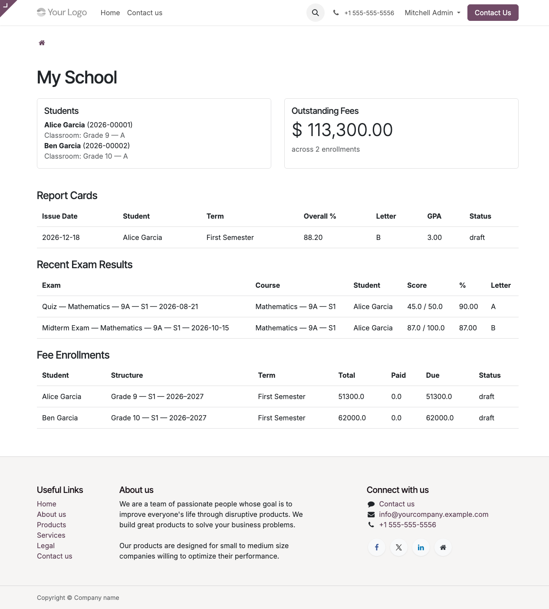

# Giving students and guardians portal access

The `/my/school` dashboard is visible to anyone logged in with a portal user account whose `partner_id` matches a student or has wards. To make that happen you need to:

1. Make sure the partner is flagged correctly (`is_student` or `is_guardian`).
2. Create a portal user linked to that partner.
3. Send them the invitation email.

## 1. Verify the partner flags

Open the student or guardian record (`School → Students` or `School → Guardians`).

- A **student** should have `is_student = True`.
- A **guardian** should have `is_guardian = True` and be linked to the student via the **Guardians** tab on the student form (or **Wards** tab on the guardian form — both sides of the same symmetric M2M).

If you want a single portal login that can see multiple kids (typical for parents), put the parent's partner record as a guardian on all their kids.

## 2. Create the portal user

From the guardian's or student's partner form, use **Action → Grant Portal Access** (Odoo 19 shipped action). If you don't see it:

1. Settings → Users & Companies → Users → **New**.
2. Fill in:
   - **Name**: the guardian/student's name.
   - **Login / Email**: their email address.
   - **Related Partner**: the partner record you're giving access to.
   - **User Type**: **Portal User**.
3. Save.

The **User Type → Portal User** choice is important — it puts the user in `base.group_portal`, which is what the record rules check against to scope data visibility.

## 3. Send the invitation

Click **Send Invitation Email** on the new user. Odoo emails them a link to set their password. After they do, `/my/school` is available.

If outgoing email isn't configured yet, you can either:

- Set the password manually (Users → user → **Change Password**) and hand-deliver the credentials.
- Configure Settings → Technical → Outgoing Mail Servers first.

## 4. What they see

The portal dashboard at `/my/school` shows, **only for records tied to their partner or their wards**:

- Students block — who they can see data for.
- Outstanding fees across all their enrollments.
- Report cards (most recent 10).
- Recent exam results (most recent 15).
- Fee enrollments (most recent 10).

Data scoping is enforced at the ORM level via record rules defined in `school_portal`. Portal users can't see other families' data even if they know the record IDs.

## 5. Revoking access

Settings → Users & Companies → Users → open the portal user → **Archive** (or tick **Active** off). They can no longer log in, but their record history is preserved.

## Common setups

### One parent, two kids

- Parent partner: `is_guardian = True`.
- Both kids' partner records: tick the parent in their **Guardians** tab.
- One portal user linked to the parent's partner.
- Portal shows a Students block with both kids, outstanding fees summed across both enrollments, and every ward's report cards and exam results interleaved.

### Adult learner / college student

- Student's own partner: `is_student = True`.
- Create a portal user linked directly to the student partner.
- Portal shows just their own data.

### Divorced/separated parents

- Each parent is their own partner with `is_guardian = True`.
- Both are listed in the kid's **Guardians** tab.
- Each gets their own portal user. Both see the same ward data.
- Invoice followers automatically include all guardians, so both get fee notifications.

## Troubleshooting

**Portal user logs in but sees "There is no school data linked to your account yet."**

The user's `partner_id` has neither `is_student` nor `is_guardian` set, or they have no wards. Verify the partner record.

**Portal user sees someone else's data**

Shouldn't happen with the shipped record rules. If it does, audit:

- `School Portal: Report card: portal user owns it` (and similar rules) in Settings → Technical → Security Rules.
- `base.group_portal` membership.

Report it as a bug — record-rule regressions are serious.

## Next steps

- [Portal dashboard walkthrough →](../portal-guides/01-student-and-guardian-dashboard.md)
- [Mail templates and automation →](08-communications.md)
