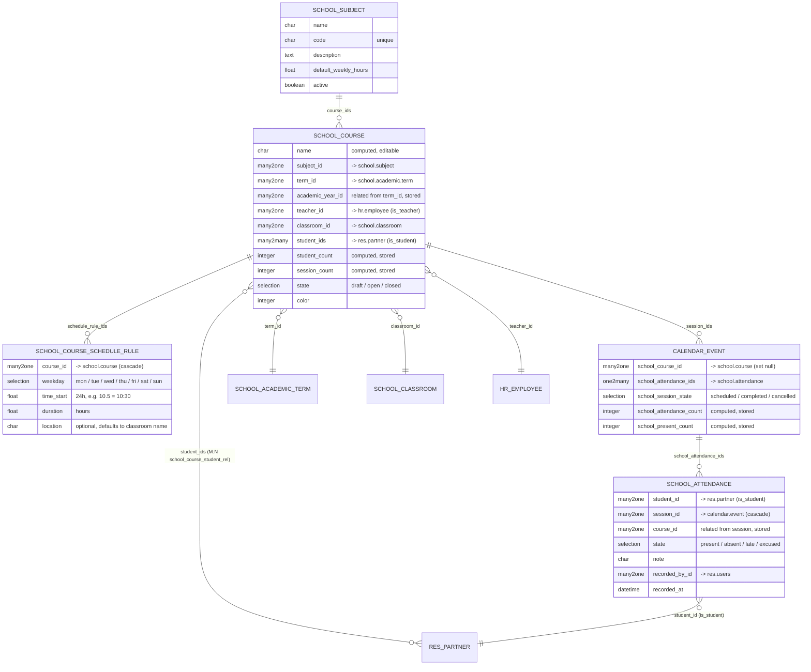

# `school_academics` — Entity Relationship Diagram



## Notes

- **Auto-enrollment** runs in `school.course.create()`: any course created without an explicit `student_ids` value is seeded from `classroom_id.student_ids`. Subsequent changes to the classroom roster do **not** auto-propagate — the **Re-sync Roster** action on the course is the explicit way to pull in new students (or `action_reset_enrollment()` programmatically).
- **Sessions are regular `calendar.event` records**, extended with a few school fields. The inverse field `session_ids` on `school.course` is a One2many to `calendar.event` filtered by `school_course_id`.
- **Materialise Sessions** (`school.course.action_materialize_sessions`) walks `term_id.date_start → term_id.date_end`, iterates the course's schedule rules per weekday, and creates a `calendar.event` for every `(date, time_start)` tuple that doesn't already exist — so the action is safe to re-run.
- **Attendance** enforces `UNIQUE(student_id, session_id)` at the DB level and verifies enrollment at the ORM level (`@api.constrains`). The `course_id` field is a stored related for fast filtering.
- **"Mark All Present"** (`calendar.event.action_school_mark_all_present`) only creates rows for enrolled students that don't already have one — it never overwrites existing attendance — and flips the session to `completed`.
```
