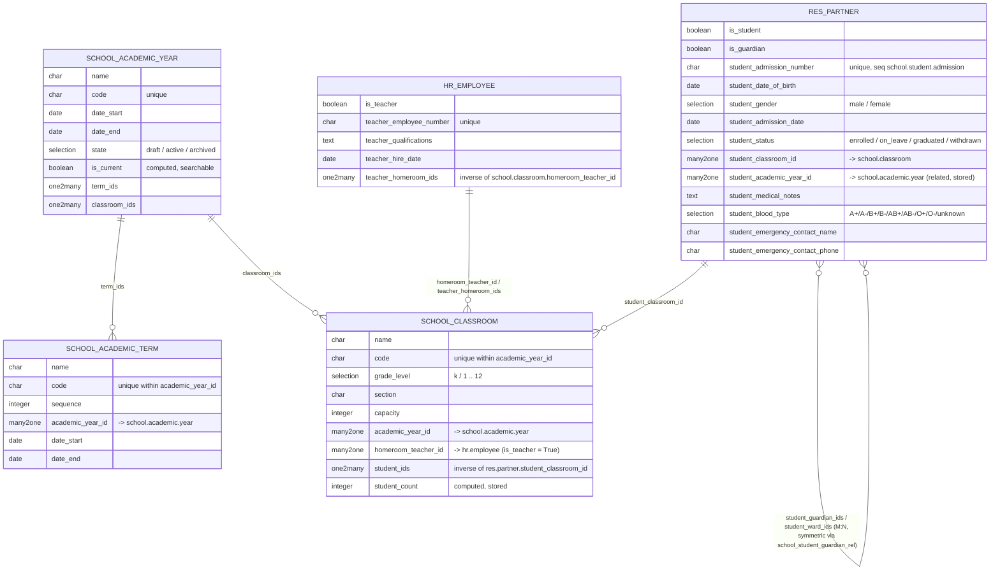

# `school_base` — Entity Relationship Diagram

## Notes

- **Guardian ↔ Ward** is a symmetric many-to-many on `res.partner` implemented with a single relation table `school_student_guardian_rel` and swapped columns — assigning a guardian on a student automatically shows up as a ward on the guardian.
- **Access control** is group-based (Reader / User / Manager) bound to the Odoo 19 `res.groups.privilege` "School Management". Record rules are deferred to later modules.
- **Admission numbers** come from `ir.sequence` code `school.student.admission` (format configurable in the UI under School → Configuration → Admission Number Sequence). Default pattern: `<year>-NNNNN`, e.g. `2026-00001`.
- **Homeroom teacher is optional** on classroom. The relation is modelled canonically on `school.classroom.homeroom_teacher_id`; the `hr.employee.teacher_homeroom_ids` one2many is the inverse view.

## Downstream extensions (added by later modules)

Per repo convention, when a later module extends an `_inherit` target defined here, the addition is documented back on this ERD. Current known extensions:

- **`res.partner.canteen_allergy_tag_ids`** — `Many2many('school.canteen.dietary.tag')`. Added by `school_canteen`; purchases block when the student's allergies intersect the items' dietary tags.

For the full picture of each downstream extension, see the module's own ERD under `docs/guide/`:

- `school_academics-erd.md` — courses reference `res.partner` students as m2m and `hr.employee` as teacher.
- `school_fees-erd.md` — fee enrollments reference `res.partner` students.
- `school_canteen-erd.md` — wallets reference `res.partner` students, allergy tags extend `res.partner`.
- `school_shop-erd.md` — sales reference `res.partner` as buyer.
- `school_transport-erd.md` — assignments reference `res.partner` students.
- `school_exams-erd.md` — exam results and report cards reference `res.partner` students.
