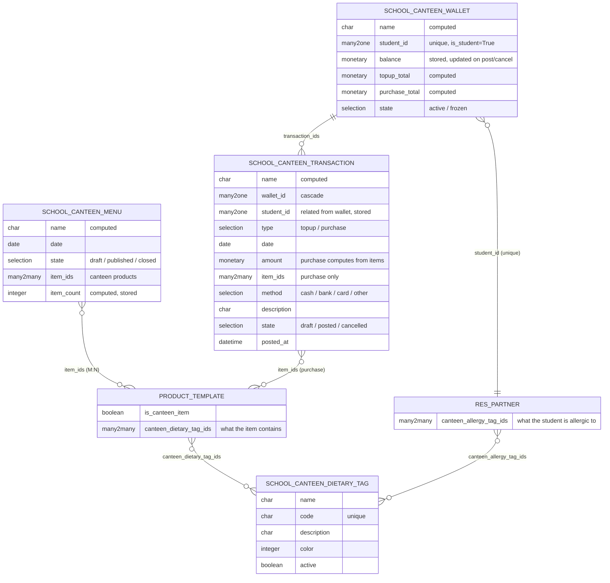

# `school_canteen` — Entity Relationship Diagram



## Notes

- **Same dietary tag model is reused on both sides** — item has `canteen_dietary_tag_ids` (what it contains) and student has `canteen_allergy_tag_ids` (what they're allergic to). Purchase validation intersects the two sets; any overlap blocks the post with a ValidationError.
- **Wallet balance is stored** and explicitly adjusted inside `action_post` / `action_cancel`. The `topup_total` / `purchase_total` / `transaction_count` fields are computed from posted transactions for display.
- **Single-record per student** enforced by `UNIQUE(student_id)` on the wallet.
- **Transaction constraints** — positive amount (`@api.constrains`), wallet must be active when posting (UserError), sufficient balance on purchase (UserError), and the allergy-intersection rule (ValidationError). Cancelling a posted transaction reverses its balance effect.
- **No menu coupling** — purchases don't have to be from today's `school.canteen.menu`. The menu is a display roster for students/staff, not a hard gate.
```
