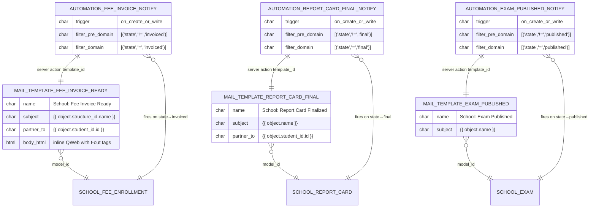

# `school_comms` — Entity Relationship Diagram

`school_comms` defines no new business models — it ships **data records** only: three `mail.template` records and three `base.automation` rules that wire them to state transitions on upstream school models. Each automation rule also owns an `ir.actions.server` record that the rule invokes.

## Notes

- **No new Odoo models** are defined. `school_comms` is purely configuration: three `mail.template` records, three `base.automation` records, and three `ir.actions.server` records that belong to the automations (`usage='base_automation'`, `state='mail_post'`).
- **State-transition semantics** are expressed via the pre/post filter domain pair: the pre-domain matches BEFORE the write, the post-domain matches AFTER — so the rule only fires on the exact transition into the target state.
- **Mail delivery** uses `mail_post_method='comment'` so messages land in the record's chatter, which reaches all followers (including guardians, who are auto-subscribed by upstream modules like `school_fees`).
- **No QWeb CDATA** in the template body — Odoo 19's RelaxNG schema rejects `type="html"` fields with CDATA; templates use inline HTML with `<t t-out>` directives instead.
