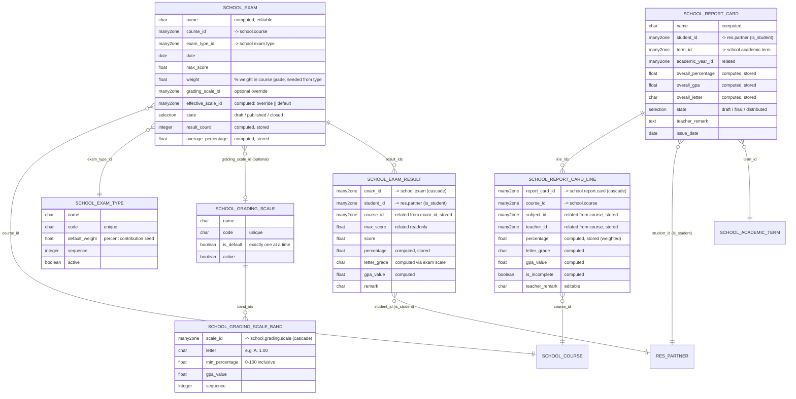

# `school_exams` — Entity Relationship Diagram



## Notes

- **Default scale** — Exactly one `school.grading.scale` has `is_default = True`. Enforced via `@api.constrains`, not a partial unique index.
- **Band lookup** — `scale.band_for_percentage(pct)` returns the highest-`min_percentage` band whose threshold is ≤ `pct`. Below every band → returns the lowest band (so `letter_grade` is always produced).
- **Effective scale** — `exam.effective_scale_id` is `grading_scale_id || get_default_scale()`. Results always pick up the correct scale for computed grades.
- **Weighted course grade** — Σ(r.percentage × r.exam.weight) / Σ(r.exam.weight) over the student's graded results (exam state ∈ {published, closed}, weight > 0) for the course. Incomplete lines (no graded exams) skip from the overall aggregate.
- **Overall GPA** — mean of line `gpa_value` for non-incomplete lines; overall letter looked up against the default scale.
- **Unique constraints** — scale code, exam-type code, (exam, student) results, (student, term) report cards, (report_card, course) lines.
- **PDF** — `ir.actions.report` (`report_type="qweb-pdf"`) on `school.report.card`, bound via `binding_model_id` so "Print → Report Card" appears on the record.
```
