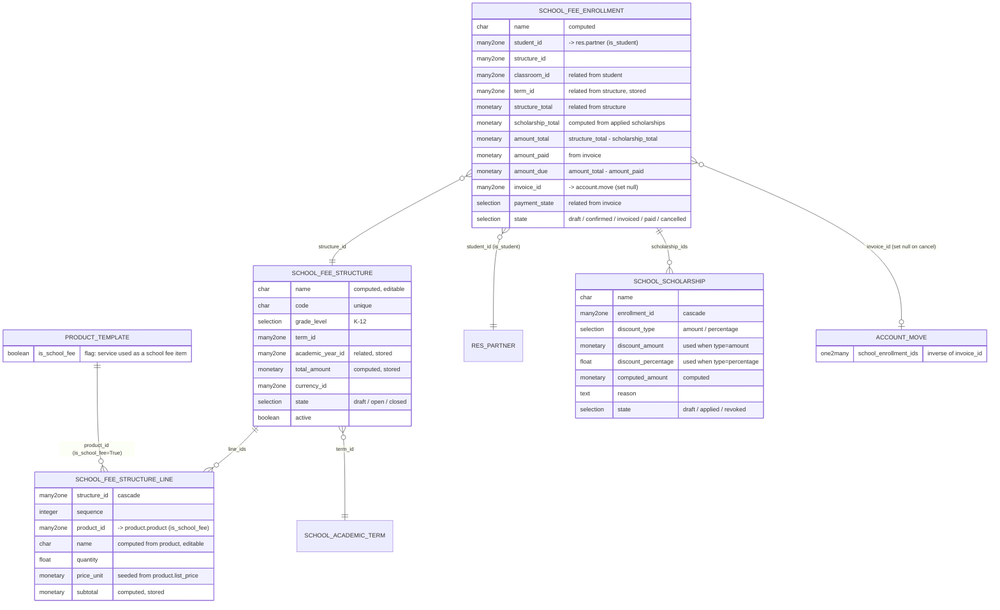

# `school_fees` — Entity Relationship Diagram



## Notes

- **Fee items are Odoo products.** The `is_school_fee` flag lives on `product.template` and narrows the Configuration > Fee Items list + the fee structure line's product picker. No parallel fee-item model.
- **Grade enforcement.** A `school.fee.enrollment` rejects students whose classroom grade doesn't match the structure's grade (`@api.constrains`).
- **Scholarship XOR.** `discount_type` picks one of `amount` / `percentage`; Python constraint forbids setting the other field at the same time. Percentage must be in `(0, 100]`; amount must be `> 0`.
- **Invoice flow.** `action_generate_invoice` creates a draft `account.move` (`out_invoice`) with one line per structure line plus one negative line per applied scholarship. Guardians are auto-subscribed as followers. The invoice is NOT auto-posted — Accounting reviews + posts.
- **Regeneration.** Once invoiced, changes (new scholarship, amount correction) require **Cancel** on the enrollment (cancels the draft invoice too) + regenerate. Posted invoices must first be reset to draft in Accounting.
- **Relationship back to enrollment.** `account.move.school_enrollment_ids` is the one2many inverse of `school.fee.enrollment.invoice_id`, used by the "Fee Invoices" menu action to filter to school invoices only.
- **Unique constraints.** Structure code is globally unique; `(grade_level, term_id)` is unique; enrollment `(student_id, structure_id)` is unique. All other domain constraints are enforced via `@api.constrains`.
```
