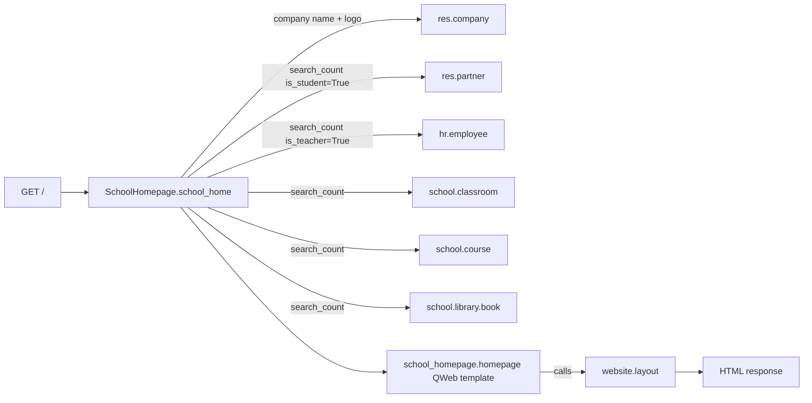

# `school_homepage` — Entity Relationship Diagram

`school_homepage` defines no new business models. It ships a single HTTP controller + a QWeb template, backed by live `search_count` reads of entities defined in upstream modules. The "ERD" here is really a data-flow diagram — what the homepage controller reads from the rest of the suite:

## Notes

- **Route**: `GET /`, `type="http"`, `auth="public"`, `website=True`. The `website=True` flag is what makes Odoo wrap the response with the Website app's layout, menu, and editing tools.
- **No persisted state.** Every request pulls fresh counts via `sudo().search_count(...)` and renders the QWeb template. No caching beyond Odoo's standard HTTP cache.
- **Entity sources**: `res.partner` with `is_student=True` (from `school_base`), `hr.employee` with `is_teacher=True` (from `school_base`), `school.classroom` (from `school_base`), `school.course` (from `school_academics`), `school.library.book` (from `school_library`). Those upstream models own their own ERDs under `docs/guide/`.
- **Website editing**: because the template uses `<t t-call="website.layout">`, administrators can navigate to `/` on the public site, click **Edit**, and modify the copy, swap the hero image, or drop website-builder snippets — without touching this module's code.
- **Dependency graph**: `school_homepage` depends on `website` plus all ten upstream `school_*` modules so it can reliably reference every entity it counts. Installing `school_homepage` pulls in the complete School Management System suite.
