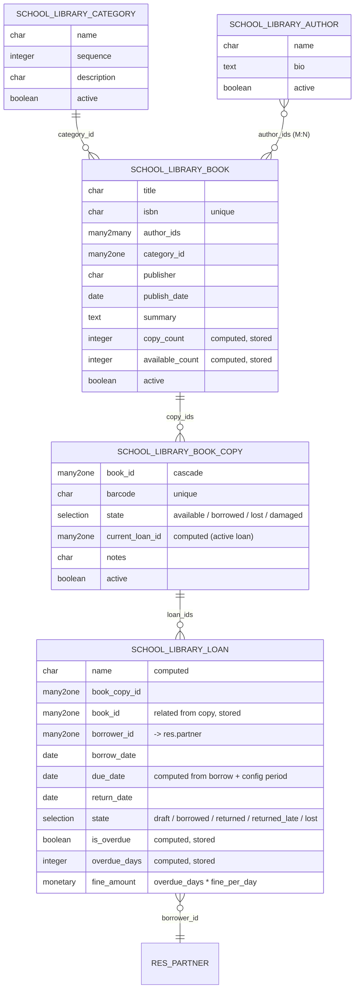

# `school_library` — Entity Relationship Diagram



## Notes

- **Catalog split** — `school.library.book` is the title record; `school.library.book.copy` is the individually-barcoded physical copy. Loans attach to a copy, so the same title can circulate many times in parallel.
- **Copy state is loan-driven** — confirming a loan flips the copy to `borrowed`; returning/marking-lost restores or transitions accordingly. The `current_loan_id` helper is computed from the copy's active loan.
- **Fine calculation** is computed on the loan from `overdue_days × fine_per_day` (config param `school_library.fine_per_day`, default 5.0). No separate fine model for MVP.
- **Due date defaults** to `borrow_date + loan_period_days` (config param, default 14). Admin can override on the loan form.
- **Constraints** — `due_date > borrow_date`, `return_date ≥ borrow_date`, a copy can only be on one `borrowed` loan at a time.
```
