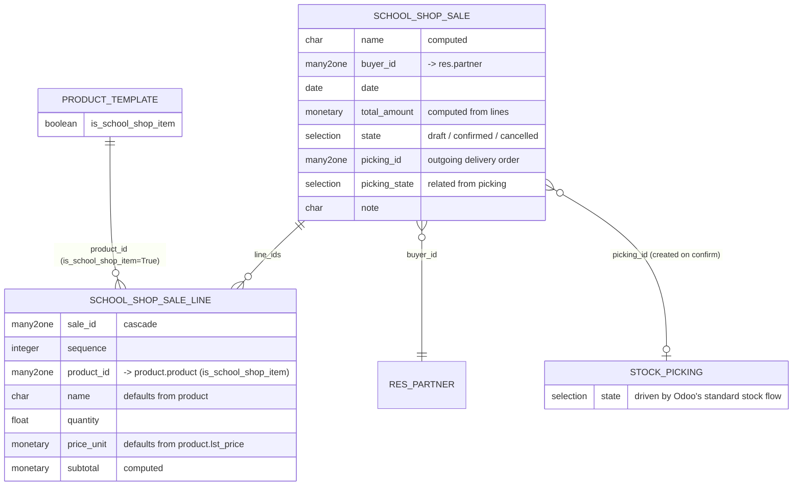

# `school_shop` — Entity Relationship Diagram



## Notes

- **Sale confirmation creates a stock.picking** (outgoing delivery) only when at least one line references a storable product and a default outgoing picking type exists. For `consu` (non-storable) lines only, the sale still confirms but no picking is generated — nothing to move through inventory. This mirrors Odoo's sale/stock integration heuristic.
- **Sale cancel cancels the picking** (unless it's already in `done` or `cancel` state). **Reset to Draft** refuses to proceed if the picking is done, otherwise cancels it and unlinks.
- **Inventory accounting** is fully delegated to Odoo's `stock` module; the sale just surfaces `picking_state` for quick visibility.
- **No `sale` module dependency.** A parallel `school.shop.sale` model stays scoped to school ops without dragging in price lists, sale teams, or the full CRM stack.
```
