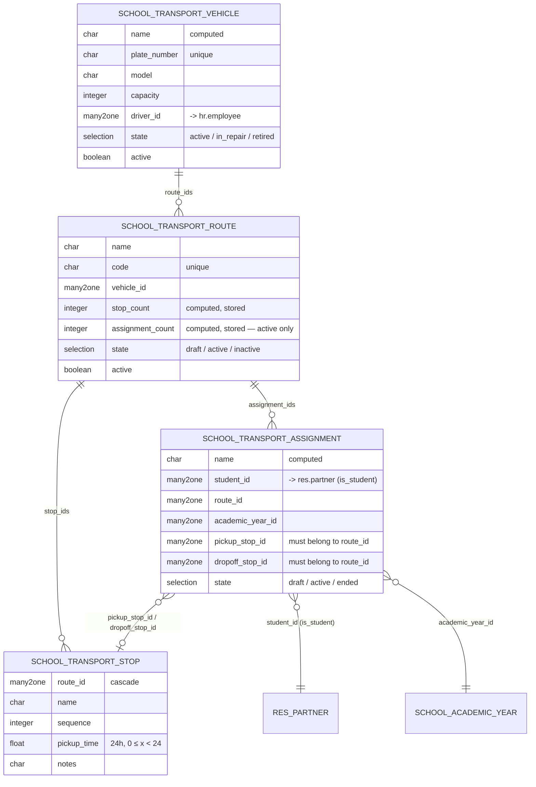

# `school_transport` — Entity Relationship Diagram



## Notes

- **One active assignment per (student, year).** Enforced by a PostgreSQL `EXCLUDE USING btree` partial constraint filtered on `state = 'active'`. A student can have multiple historical (draft / ended) records for the same year, but only one concurrently active.
- **Stop-must-belong-to-route** check is an `@api.constrains` on assignment — the view already domain-filters the stops, but the constraint is the source of truth.
- **Route and stop cascade delete** — removing a route drops its stops (and you'd normally unlink or end its assignments manually first).
- **No sale / account coupling.** Transport fees, if billed, would be handled in `school_fees` via a structure referencing a dedicated product. Keeping transport lean makes the module reusable for schools that bundle transport into tuition vs charge separately.
```
