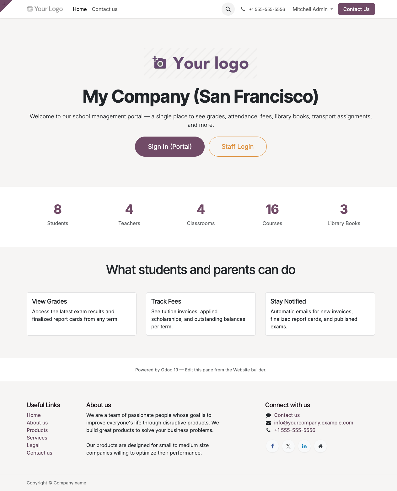

# What is the School Management System

The School Management System (SMS) is a set of **11 Odoo 19 Community Edition modules** that together cover the complete student lifecycle for a K–12 school: admissions, class scheduling, grading, tuition billing, library, canteen, transport, parent self-service, and outbound notifications.

## Module dependency graph

```
school_homepage   ← public landing page at /
    │
    ├── school_portal      ← /my/school dashboard
    ├── school_comms       ← mail templates + automation
    ├── school_transport   ← buses, routes, assignments
    ├── school_shop        ← uniforms, books (stock-backed)
    ├── school_canteen     ← menus, wallets, allergy checks
    ├── school_library     ← catalog, copies, loans
    ├── school_fees        ← fee structures, invoicing
    ├── school_exams       ← scales, exams, report cards
    └── school_academics   ← subjects, courses, attendance
                │
                └── school_base  ← students, guardians,
                                  teachers, classrooms,
                                  academic years, terms
```

Installing `school_homepage` transitively installs every other module. You can also install a narrower subset — e.g. `school_fees` pulls only `school_base` + `account` + `product` + `mail`.

## Who uses it

| Role | Typical tasks | Main touchpoint |
|---|---|---|
| **Registrar / Admin** | Add students, manage classrooms, generate fee invoices, issue report cards, print PDFs | Odoo backend (`/web`) |
| **Teacher** | Mark attendance, enter exam results, add comments to report cards | Odoo backend (`/web`) |
| **Librarian** | Add books, create copies, check books in and out | Odoo backend (`/web`) |
| **Canteen / Cashier** | Top up student wallets, record purchases | Odoo backend (`/web`) |
| **Driver / Transport Coordinator** | Look up route assignments | Odoo backend (`/web`) |
| **Student / Parent** | View grades, fees, schedules; download report-card PDFs | Portal (`/my/school`) |

## What the landing page looks like

When you install `school_homepage` and visit `http://<your-host>/`, you see a public landing page pulling live stats from the rest of the suite:



The hero pulls from `res.company` (name + logo), the stats row runs `search_count` on each model, and the CTAs point to `/my` (portal) and `/web` (backend).

## Access model

Everything is gated by three groups under a single **School Management** privilege (Odoo 19's `res.groups.privilege`):

| Group | Can do |
|---|---|
| **Reader** | Read everything school-related. No writes. |
| **User** | Create / edit students, courses, attendance, exam results, fee enrollments, scholarships, library loans, canteen transactions, shop sales, transport assignments. |
| **Manager** | Everything User can do plus: academic year lifecycle, grading scales, fee structures, library catalog, dietary tags, product flags, automation-rule management. |

Portal users (students + guardians) see **only their own data** through the dashboard at `/my/school`, enforced by record rules.

## Next steps

- [Install the stack →](02-installation.md)
- [First login →](03-first-login.md)
- [Add your first student →](../admin-guides/01-adding-a-student.md)
