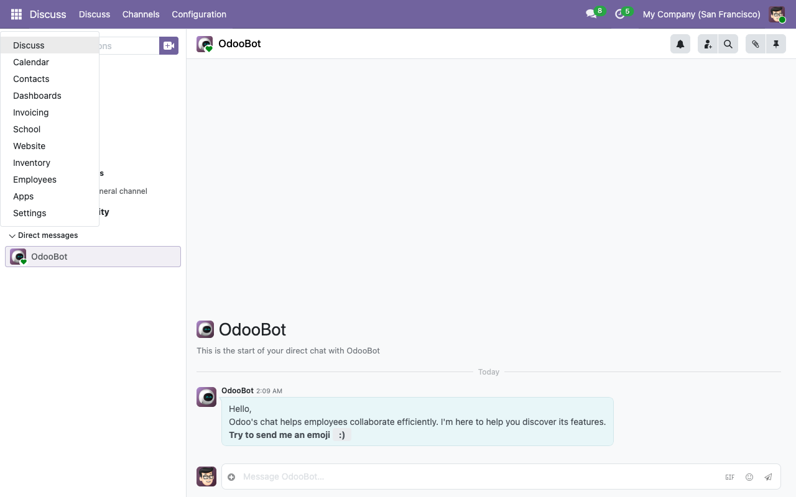

# Installing the School Management System

The repository ships a Docker Compose stack — PostgreSQL 16 and Odoo 19 Community — configured to mount the repo as an Odoo custom addons path. You can be up and running in under five minutes on any host with Docker.

## Prerequisites

- Docker Desktop / Docker Engine 24+ with Compose v2.
- ~2 GB free disk for the Odoo image + PostgreSQL data volume.
- Ports `8069` (Odoo HTTP) and `5433` (PostgreSQL, exposed by `docker-compose.override.yml` for local dev) free.

## 1. Clone and configure

```bash
git clone <repo-url> odoo-school
cd odoo-school
echo 'POSTGRES_PASSWORD=odoo-dev-password' > .env
```

`.env` is gitignored — safe to keep a local dev password there. Production setups should use a stronger secret and a separate `.env.prod` or a secret manager.

## 2. Bring the stack up

```bash
docker compose up -d
```

First boot pulls the `odoo:19.0` and `postgres:16-alpine` images (~600 MB combined). Subsequent boots are instant.

Sanity check:

```bash
curl -s -o /dev/null -w "%{http_code}\n" http://localhost:8069/
# 303  (redirects to the DB selector on first run)
```

## 3. Create a database and install the suite

Use the one-shot container form so you don't interfere with the long-running Odoo process:

```bash
docker compose run --rm --no-deps odoo odoo \
    -d school_dev \
    -i school_homepage \
    --without-demo=False \
    --stop-after-init
```

What that does:

- `-d school_dev` — creates or uses a database named `school_dev`.
- `-i school_homepage` — installs `school_homepage`, which transitively pulls in every other `school_*` module (the full suite).
- `--without-demo=False` — load the demo data (students, teachers, classrooms, courses, exam results, etc.). Omit or set to `--without-demo=all` for an empty install.
- `--stop-after-init` — exit once modules are installed rather than starting the web server.

Expect 1–2 minutes for a first install: Odoo creates ~60 base tables, runs migrations for each school module, and seeds the demo data.

When the one-shot finishes, the long-running Odoo service (started by `docker compose up -d`) already serves that database.

## 4. Visit the site

- **Public homepage**: <http://localhost:8069/>
- **Portal**: <http://localhost:8069/my>
- **Backend** (staff): <http://localhost:8069/web>

Default credentials on a fresh demo install: **admin / admin**.

## 5. Grant yourself School Manager rights

The admin user has full technical privileges by default, but the School suite uses its own privilege groups. To see every menu and bypass record rules, grant yourself the **School Manager** group:

1. Log in as `admin`.
2. Settings → Users & Companies → Users → **Mitchell Admin**.
3. Scroll to the **Access Rights** section and tick **School Management → Manager**.
4. Save.



After saving, refresh the page — the **School** app appears in the top-left apps menu.

## Troubleshooting

**Odoo logs show `ModuleNotFoundError: No module named 'odoo.addons.school_...'`**

The running container started before the new module was added to the addons path. Restart Odoo:

```bash
docker compose restart odoo
```

**Database selector shows many `*_test` databases**

Those are leftover test DBs from the CI / dev cycle. Drop them with:

```bash
docker compose exec -e PGPASSWORD=odoo-dev-password db \
    psql -U odoo -d postgres -c "DROP DATABASE <name>"
```

**`connection to server at "db" failed: fe_sendauth: no password supplied`**

The shell didn't get the DB password. Pass it explicitly: `odoo shell --db_password=odoo-dev-password ...`.

## Next steps

- [First login and initial setup →](03-first-login.md)
- [Add a student →](../admin-guides/01-adding-a-student.md)
