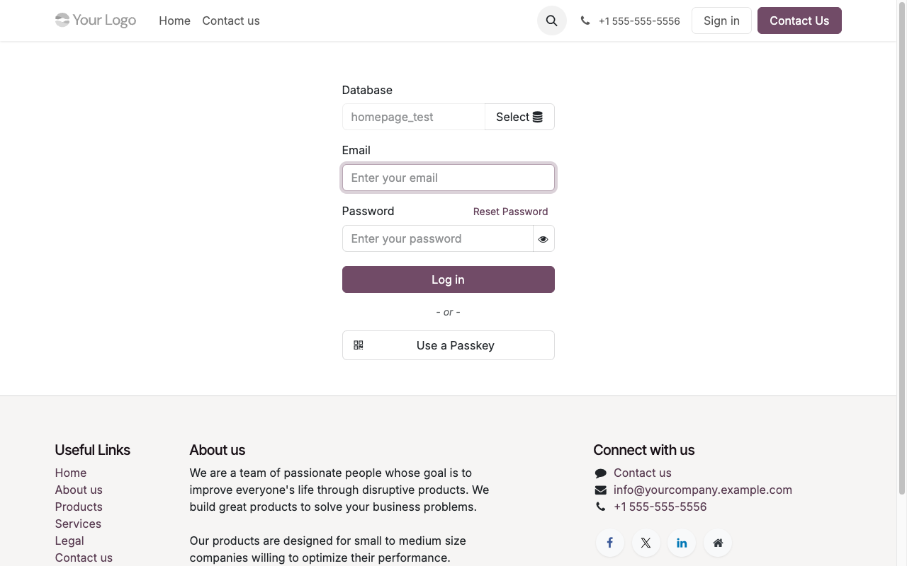
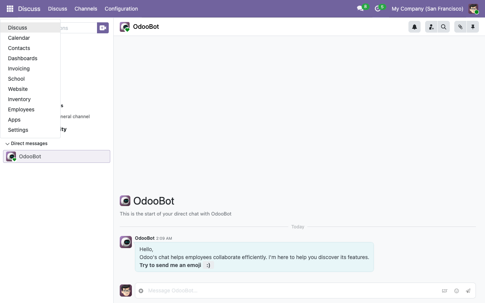
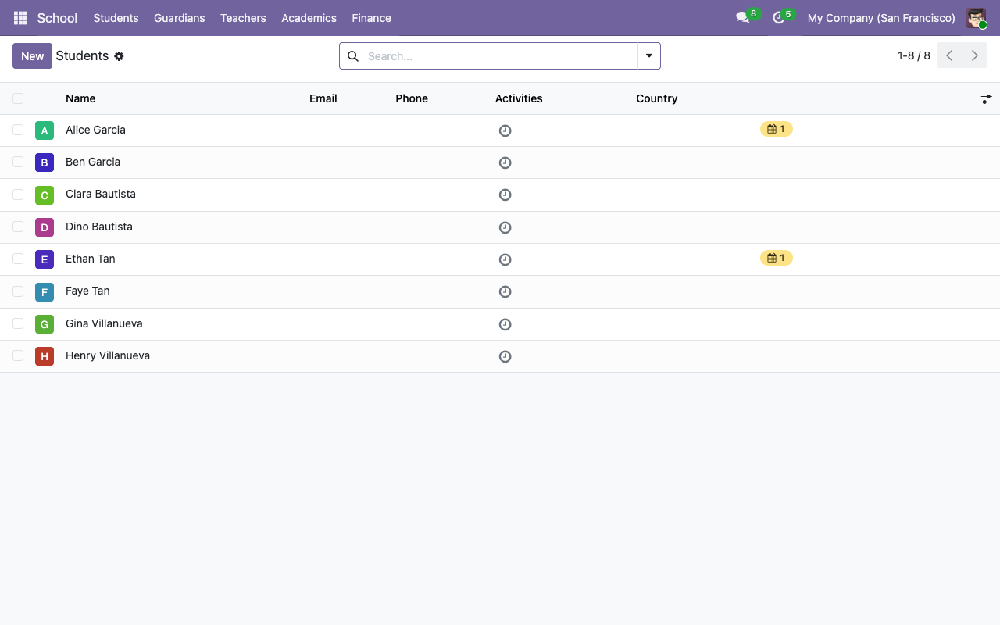

# First login and initial setup

Assumes you've completed the [installation](02-installation.md) and have the stack running at `http://localhost:8069/`.

## Log in

Visit **<http://localhost:8069/web/login>**. Default credentials on a fresh demo install: **admin / admin**.

## Set your school identity

The public homepage at `/` pulls the school name and logo from `res.company`. Update them once on first boot:

1. **Settings → Users & Companies → Companies → My Company**.
2. Replace the name with your school's name (e.g. *Riverside Elementary*).
3. Upload the school crest / logo in the top-left image field.
4. Update address, phone, email — these surface on invoices and the report-card PDF footer.

## Grant School Manager to your admin user

If you followed the install guide you've already done this. If not:

1. **Settings → Users & Companies → Users → Mitchell Admin** (or whatever your admin is named).
2. Tick **Access Rights → School Management → Manager**.
3. Save and hard-refresh (`Cmd/Ctrl + Shift + R`).

The **School** app will now be visible in the top-left apps grid:

Click **School** and you land on the Students list. On a demo install, you'll see the 8 pre-loaded students:

## Tour of the top menu

| Menu | What's under it |
|---|---|
| **Students** | All `res.partner` records flagged as `is_student`. Their profile form holds admission number, classroom, guardians, medical notes, emergency contact. |
| **Guardians** | Partners flagged `is_guardian` — typically the people who pay fees and receive notifications. |
| **Teachers** | `hr.employee` records flagged `is_teacher`. Their profile form has the Teaching tab and the list of homeroom classrooms. |
| **Classrooms** | Each classroom is scoped to an academic year with a grade level (K–12) and a homeroom teacher. |
| **Academics** | Subjects, Courses, Sessions (`calendar.event`), Attendance, Exams, Exam Results, Report Cards. |
| **Library** | Books, Copies, Loans. |
| **Finance** | Fee Enrollments, Fee Invoices, Scholarships. |
| **Canteen** | Wallets, Transactions, Daily Menus. |
| **Shop** | Sales. |
| **Transport** | Routes, Assignments, Vehicles. |
| **Configuration** (under the gear) | Academic Years, Terms, Admission Number Sequence, Subjects, Grading Scales, Exam Types, Fee Structures, Fee Items, Library Categories / Authors, Dietary Tags, Shop Items. |

## What the demo data contains

If you installed with `--without-demo=False`, the system is seeded with enough data to showcase every module:

- 1 academic year (2026–2027) with 2 terms (S1 Fall, S2 Spring).
- 4 classrooms — Grade 9 A/B, Grade 10 A/B — each with a homeroom teacher.
- 4 teachers — Maria Santos (Math), Juan Dela Cruz (Science), Anna Reyes (English), Pedro Mendoza (History).
- 4 families × 2 guardians × 2 students = **8 guardians, 8 students**, all cross-linked.
- 16 courses (every subject × every classroom) with weekly schedule rules.
- 2 published Math 9A exams with real grades for Alice (88.2% B) and Ethan (75.2% C).
- A draft report card for Alice covering S1 2026–2027.
- 2 fee structures (Grade 9 ₱57k, Grade 10 ₱62k) and 2 draft enrollments.
- A 10 % merit scholarship on Alice's enrollment.
- 3 library books × 2 copies each, with one active loan (Alice borrowed HP#1).
- 3 canteen products with dietary tags, 2 wallets, a posted top-up and a purchase.
- 3 shop products and 1 draft sale for Carlos Garcia.
- 2 transport routes with 3 stops each, 3 active student assignments.
- 3 mail templates + 3 automation rules ready to fire.

## Next steps

You're ready to use the system. The most common workflows are covered in:

- [Adding a student →](../admin-guides/01-adding-a-student.md)
- [Setting up exams →](../admin-guides/04-exams-and-grades.md)
- [Generating fee invoices →](../admin-guides/05-fees-and-invoices.md)
- [Running the library →](../admin-guides/06-library.md)
