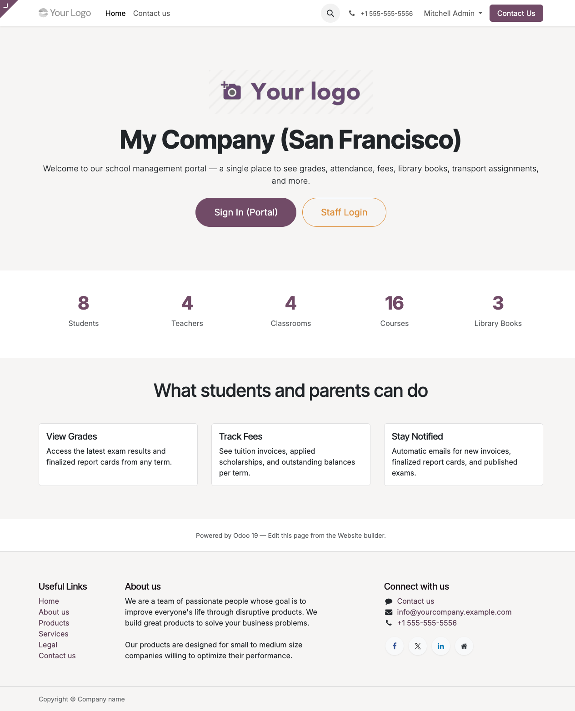

# School Management System

A suite of **11 Odoo 19 Community Edition modules** covering the full student lifecycle: admissions, academics, exams, fees, library, canteen, shop, transport, parent portal, notifications, and a public homepage.

## What lives where

| Area | Covered by |
|---|---|
| Students, guardians, teachers, classrooms, academic years, terms | [`school_base`](../../school_base/README.md) |
| Subjects, courses, weekly schedules, sessions, attendance | [`school_academics`](../../school_academics/README.md) |
| Grading scales, exams, results, report cards + PDF | [`school_exams`](../../school_exams/README.md) |
| Fee items, structures, enrollments, scholarships, invoices | [`school_fees`](../../school_fees/README.md) |
| Book catalog, copy tracking, loans, overdue fines | [`school_library`](../../school_library/README.md) |
| Daily menus, prepaid wallets, allergy-aware purchases | [`school_canteen`](../../school_canteen/README.md) |
| Uniforms, textbooks, and supplies with stock integration | [`school_shop`](../../school_shop/README.md) |
| Buses, routes, stops, student transport assignments | [`school_transport`](../../school_transport/README.md) |
| Student/guardian dashboard at `/my/school` | [`school_portal`](../../school_portal/README.md) |
| Mail templates + automation rules | [`school_comms`](../../school_comms/README.md) |
| Public website-editable landing page at `/` | [`school_homepage`](../../school_homepage/README.md) |

## How to read this wiki

- **[Getting Started →](getting-started/)** — install the stack, initialise a database, get to your first login.
- **[Admin Guides →](admin-guides/)** — everyday workflows: adding students, creating exams, generating fee invoices, managing library loans, ...
- **[Portal Guides →](portal-guides/)** — what students and guardians see when they sign in at `/my/school`.
- **[Reference →](reference/)** — architecture diagrams, permission matrices, Odoo 19 specifics you need to know.
- **[Operations →](operations/)** — backup, restore, upgrading between Odoo versions.

Every page that shows a UI flow has a screenshot captured from a fresh install with the shipped demo data — you should see the same thing on your install if you tick "Load demonstration data" when creating the database.

## Conventions

- Paths are relative to the repo root (e.g. `school_exams/models/school_exam.py`).
- Where a setting belongs in the Odoo UI, the full breadcrumb is spelled out: **Settings → Technical → Email → Templates**.
- Code blocks marked as `bash` run on your host (inside the project directory). Code blocks marked as `python` run inside the Odoo container shell.

## Support

Issues, questions, or feature requests: see the project repo's issue tracker. For operational emergencies, contact the school's IT administrator first — production data isn't fixable from a wiki.
