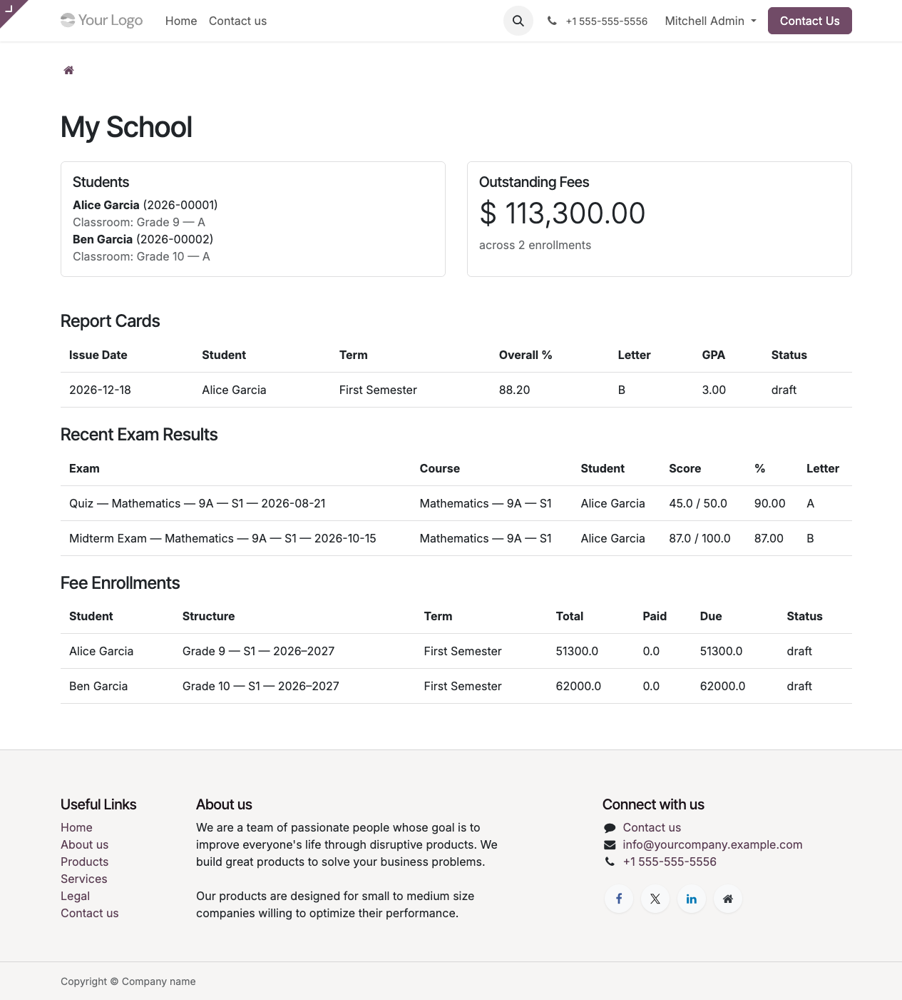

# Using the /my/school dashboard

The parent/student portal is at **`/my/school`** on your school's domain. Log in with the credentials the school sent you and you'll see one page with everything you typically need:

## Sections

### Students

The top-left card lists the student(s) this account can see data for:

- If you're a **guardian** (typical parent), it shows every child linked to your account with their admission number and current classroom.
- If you're the **student** themselves (adult learners, college students), it shows just your own record.

Click a student's name to navigate straight to their detail view (if the Website menu is configured to let you).

### Outstanding Fees

Top-right. The running total of **Amount Due** across every fee enrollment for every student on your account. Useful for seeing "how much do we owe this term?" at a glance.

The number excludes enrollments in `draft` state (not yet invoiced) and `cancelled` state. So it's an accurate snapshot of what you actually need to pay.

### Report Cards

Lists the 10 most recent report cards belonging to your account's students. Columns: issue date, student, term, overall %, letter grade, GPA, and state.

A report card shows here only once the school has set its state to `final` or `distributed`. Drafts are admin-only.

### Recent Exam Results

The 15 most recent individual exam results across all courses. Columns: exam name, course, student, score / max, percentage, letter grade.

### Fee Enrollments

The 10 most recent fee enrollments — one per student per term. Columns: student, structure name, term, total amount, paid, due, status.

## What you can't do (yet)

The current portal is **read-only**. You can see grades and fees but you can't:

- Download report-card PDFs directly from this page (planned).
- Pay an invoice online (planned — would need an Odoo payment provider wired up).
- Message the teacher from the dashboard.
- Excuse an absence.

Those round-trips still happen out-of-band (email the school, drop a note with your kid, call the office).

## Logging in

Visit your school's `/web/login` URL. Enter the email + password the school set for you. If you forgot the password, click **Reset Password** on the login screen — Odoo emails you a reset link.

Staff users (teachers, admins) have access to the full backend at `/web` — if you're one of them, the portal is optional. Portal users can **only** see `/my/*` pages; the `/web` backend is blocked for them.

## Security and privacy

- You see only data tied to your own account or your wards — enforced at the database query level by record rules.
- The portal is served over the same HTTPS as the main site; you can't be downgraded to HTTP.
- Your password is hashed in the Odoo database with bcrypt.
- The school can revoke your access at any time by archiving your user account.

If you think you can see another family's data, **email the school immediately** — it's a security bug.

## Browser support

Modern Chrome / Firefox / Safari / Edge — whatever you browse the rest of the web with. The portal uses Odoo's standard responsive layout, so it works on phones and tablets too.

## Next steps

- [How to request a PDF report card →](../portal-guides/) (contact office)
- [Back to the knowledge base home →](../home.md)
